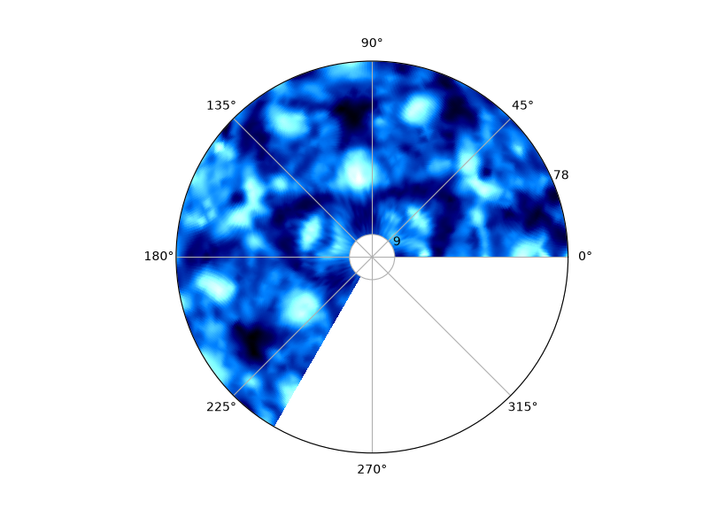

# EasyPizza

**XPS Angular Mapping.** EasyPizza is a Tkinter app for X-ray photoelectron diffraction. It turns XPS spectra measured at many emission angles into "pizza" maps: polar plots of photoemission intensity against the polar angle θ and the azimuth φ.

It has two workflows:

- **Open → Run** reads one spectrum per (θ, φ) angle. It smooths each spectrum (Savitzky–Golay), subtracts a Shirley background, fits a Gaussian (or two, with **Double Peak**) and writes the integrated intensities to an `.xpd` file with the columns `Intensity Theta Phi`.
- **Pizza!** opens an `.xpd`, `.hol` or `.dat` file and draws the angular map, either as measured or symmetrised.

## Install

You need Python 3 with Tk. The installers from python.org and the Pythons managed by `uv` include Tk. With Homebrew, install the Tk formula for your Python version, for example `brew install python-tk@3.14`. On Debian or Ubuntu, run `sudo apt install python3-tk`. To check that Tk works, run `python -c "import tkinter; tkinter.Tk()"`.

```bash
python -m venv .venv
source .venv/bin/activate
pip install -r requirements.txt
```

`requirements.txt` pins the versions this was verified with (Python 3.13.12, Tk 9.0).

## Run: your first map

```bash
python easypizza.py
```

Click **Pizza!** and choose `1ML1.xpd`, which is in the repository. The map appears in the main window, and a Configuration window opens next to it with the symmetry modes, colour maps and export. EasyPizza also saves the map as `1ML1.xpd.jpg` next to the input file.



How to read the map:

- **Angle around the circle** is the azimuth φ, counter-clockwise from 0° on the right. The first measured azimuth is placed at 0°. `1ML1.xpd` covers 0° to 240°, so the remaining sector is empty.
- **Distance from the centre** is the polar emission angle θ in degrees, on a linear scale. The two radial labels show the smallest and largest θ in the file, 9° and 78° here. The centre (θ < 9°) was not measured.
- **Colour** is the anisotropy χ = (I − ⟨I⟩θ) / ⟨I⟩θ: each intensity relative to the average of its θ ring, so rings with different overall intensity share one scale. The scale is linear from the lowest value in the map (black, through blue) to the highest (white); the app does not draw a colour bar. For `.hol` and `.dat` files the colour is the anisotropy column stored in the file, plotted as it is.

## Symmetry modes

In the Configuration window, **Raw Data** shows the measurement. **60°** and **120°** fold a 240° azimuthal scan, and **90°** folds a 270° scan. Each mode averages the intensities at equivalent azimuths, normalises the ring and repeats the sector around the full circle. The symmetrised maps are interpolated in Cartesian coordinates, and the unmeasured centre is filled with the lowest value.

## Input files

| File | Content |
| --- | --- |
| `.xpd` | Header line, then `Intensity Theta Phi`; θ and φ in degrees on a 3° grid. `1ML1.xpd` is an example. |
| `.hol` | Header line, then five columns. EasyPizza plots θ (first column), φ (second) and the anisotropy in the fifth. `Ni111_3p.hol` is an example. |
| `.dat` | Header `Theta Phi Ki`, with Ki the anisotropy. `1test.dat` is an example. |
| Spectra for **Open** | The first line holds the start energy, end energy and step (for example `Ni 3p 60.00 80.05 0.10`), the second line is skipped, then one count per line. The file name ends in `<theta>.<phi>.<extension>`, so `Ni3p_45.120.txt` means θ = 45°, φ = 120°. |

## Tests

The data processing lives in `angular_map.py`, `savitzky.py`, `shirley.py` and `gaussian.py`, and is tested without a display:

```bash
python -m unittest -v
```

The cubic interpolation of a regular θ–φ grid is not unique: SciPy can split each grid cell along either diagonal, and the choice changes between SciPy versions. The same file can therefore show small colour differences between installations, usually below 1% of the colour scale. The measured points are the same.
